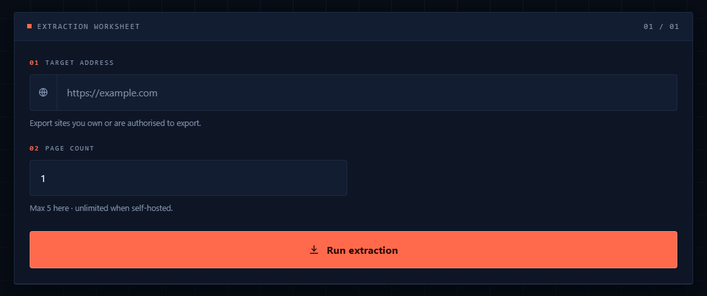

# Unframer

**Export your published Framer site to portable, framework-free HTML and CSS** that runs on any static host, opens straight from disk, and keeps its entry animations without a JavaScript runtime.

[Live web app](https://unframer-dun.vercel.app) · [Case study](https://www.niranjand.in/projects/unframer) · [Security notes](SECURITY.md) · [Contributing](CONTRIBUTING.md)



---

## What it is

A site built in Framer normally lives on Framer's hosting. Unframer takes the published site you own, reads the pages Framer already serves, and turns them into a folder of plain HTML and CSS you can put on any static host, archive, or open from your own disk. Animations are converted to CSS so the site still moves without Framer's React runtime, every page and link keeps working, and you can optionally download every image and font so the copy is fully self-contained.

It is a command-line tool, a small web app and a library, and it is intended for exporting sites you own or are authorised to export.

## Features

- **Whole-site export**: pages are discovered from `sitemap.xml` plus a bounded crawl, and written as `about/index.html`-style folders that work on any host without server configuration.
- **Animations without a runtime**: entry animations are compiled to pure CSS keyframes, with Framer's spring physics solved into CSS `linear()` curves.
- **Scroll reveals and tickers** reconstructed with a ~1.6 KB dependency-free script, designed so the page is always fully visible if that script never runs.
- **Links that work everywhere**: on disk, on a static host, and from a subdirectory.
- **Fully offline mode** (`--offline`): every image, font and media file is downloaded once and every reference, including every `srcset` variant, is rewritten.
- **Lighter pages**: analytics and tracking scripts and the roughly 212 KB React runtime are removed; component CSS, fonts, breakpoints and SVG definitions are left untouched.
- **SEO-safe copies**: `canonical` and `og:url` are retargeted with `--base-url`, or removed so a self-hosted copy is not treated as a duplicate; `sitemap.xml` and `robots.txt` are generated.
- **Full-fidelity export** (`exportsite`): alternatively keeps Framer's runtime so every interaction keeps working, downloads all assets, and ships a local preview server inside the result.
- **Deploy-ready packaging** (`--package`): a ZIP plus `netlify.toml`, `vercel.json` and `_headers` with correct cache rules.
- **Verification harness**: loads the original and the export side by side in real Chromium and compares visible text, pixels and HTML structure.
- **Web UI and API**: paste a URL, watch progress stream in, download a ZIP. Self-hostable with Docker.

## How it works

Framer server-renders each page and then hydrates it with React. The served HTML is already complete, which is what makes a static export possible, as long as the declarative data the runtime would have used is read *before* the runtime is removed.

```
discover routes (sitemap.xml + bounded crawl)
  └─ per page:  detect Framer → read appear spec + breakpoints → compile CSS
                → neutralise inline hidden state → strip runtime and trackers
                → reconstruct tickers, then scroll reveals → rewrite links / assets → write
site:  sitemap.xml + robots.txt + aggregate report  [+ host configs + ZIP]
```

Sequencing is load-bearing; see `src/extract.ts` and `src/site.ts`. Detection (`src/detect.ts`) refuses any page it cannot positively identify as Framer output, because the strip list is tied to Framer's build and running it on something else would mangle the page rather than fail cleanly.

### The trap this project exists to avoid

Framer writes each animated element's initial state inline:

```html
<div data-framer-appear-id="16xq61f" style="opacity:0.001; transform:translateY(-20px)">
```

and the animation that undoes it lives in a JSON island driven by the runtime. **Strip the runtime without compiling that JSON and every animated element stays permanently invisible.** The page renders mostly blank with no obvious cause. So `compileAppearCss` and `neutralizeInlineInitialState` always run together, and only `opacity`, `transform` and `will-change` are removed from the inline style, because the same attribute often carries real layout properties.

**Animations are breakpoint-scoped.** An appear id can carry per-breakpoint variants keyed by hash, matching the `.hidden-*` classes in the breakpoint stylesheet. Framer only emits a hashed variant where a breakpoint *differs* from the base, so `default` covers whatever breakpoints are left over. `breakpointsForDefault()` exists for exactly this and is covered by tests.

**Springs become `linear()`, not `ease-out`.** Framer drives entry animations with Motion springs (`duration` + `bounce`). `src/easing.ts` solves the spring analytically and emits a sampled CSS `linear()` curve: faithful motion with zero JavaScript.

### Interactions, and the bug that shaped them

Entry animations ship as declarative JSON, but most hidden elements do not. Framer server-renders a much larger set with an inline `opacity:0` that only its runtime reveals, and only some of them carry an appear id.

> **This shipped as a bug once.** `framer.university` has 325 such elements and *zero* appear ids. The export left 155 of them permanently invisible, hiding 4,557 characters (more than the 3,943 that were visible), including the entire navigation. The test suite passed because every invisibility assertion only looked at `[data-framer-appear-id]`.

Two reconstructions now run, in this order:

1. **Tickers.** `li.ticker-item` is a stable Framer class. The track is duplicated and translated by `-50% - gap/2`, because the two halves are separated by one extra gap; getting that wrong produces a stutter every cycle. Speed and direction are not in the page, so both are defaults and the report says so.
2. **Scroll reveals.** Each element's inline hidden state is lifted into a deduplicated CSS rule (310 elements → 5 rules on framer.university) and revealed with an `IntersectionObserver`. Tickers go first because their track is hidden inline too, and a reveal pass that claimed it would leave it visible but motionless.

**The safety property:** every hidden rule is scoped under `.uf-js`, a class set by a synchronous inline head script. If scripting is off or the script fails, the class is never added and **the page renders fully visible**. The failure mode is "no animation", never "invisible page". Verified with the class removed: 154 reveal elements rendered, zero hidden, zero trapped text.

Hover variants, accordions, carousels and scroll-linked parallax live in the compiled bundle with no reliable signature in the page, so they are left static rather than guessed at.

### Multi-page output and links

| Route | File |
|---|---|
| `/` | `index.html` |
| `/about` | `about/index.html` |
| `/blog/post` | `blog/post/index.html` |

Internal links are rewritten **relative and file-explicit** (`../../about/index.html`, not `/about` or `../../about/`). That is the only form that works opened from disk, on a static host and from a subdirectory; bare directory links rely on the server resolving an index file, which `file://` does not do.

Routes come from crawled pages, so they are untrusted input: `routeToFilePath` rejects path traversal, backslashes and drive letters, so a link can never write outside the output folder. Links to pages outside the export are made absolute back to the original site and reported, rather than left to 404 on the new host.

### Offline assets

`--offline` downloads every image, font and media file once across the whole site into `assets/images/`, `assets/fonts/`, `assets/media/` and `assets/files/`. Verified on a live two-page site: 37/37 assets downloaded, zero off-host requests in the browser. Four details carry most of the risk:

- **`srcset` is rewritten in full.** Framer ships several `?scale-down-to=` variants per image; rewriting only `src` would leave the browser quietly fetching the rest from the CDN.
- **Local names hash the full URL, query included**, because those variants share a basename and would otherwise collapse into one file.
- **Paths are relative to the page**, for the same portability reason as links.
- **Social preview images stay absolute** unless `--base-url` is set, because crawlers resolve `og:image` from outside the page. You get a warning instead of a relative path no crawler can follow.

Anything that fails to download keeps its original URL and is reported: a hotlinked asset still renders, a rewritten-but-missing one does not.

### Verifying an export

```bash
npx tsx src/cli.ts verify https://your-site.framer.website/ --export dist
```

This loads the original and the export side by side in real Chromium at 1512, 900 and 390 px and compares them:

```
VERIFICATION PASSED
Routes            2/2 passed
Text retention    100.0% (worst)
Pixel difference  11.71% (worst)
HTML structure    0 introduced, 4 pre-existing in source
```

- **Content parity**: visible text in the export against the original. This is the check that catches content disappearing, and it measures *visible* text, because `innerText` happily returns text inside `opacity:0` elements.
- **Visual diff**: pixel comparison per viewport, with diff images written to `verify-diffs/`. It is a gross-damage tripwire, not a fidelity score: a correct export differs by construction (hosting-only page elements are absent and unreconstructed parallax settles elsewhere), so the hard gates sit on the unambiguous signals and the pixel number is reported for a human to judge.
- **HTML validation against the source**: only issues the export *introduced* fail the run.

Naive browser verification lies in several ways, and each is encoded in `src/verify.ts`: a non-compositing tab never advances the animation timeline, so animations are driven with `Animation.finish()` instead of waiting; only rendered elements count, because Framer emits every responsive variant and hides the inactive ones; reveals must start *before* `finish()`, or the transition freezes at its "from" value; `finish()` throws on the infinite ticker animation; and `reducedMotion: 'reduce'` changes what the *original* renders, which once made the export look like it had more content than its source.

### Security

`unframer serve` fetches URLs supplied by whoever can reach it. `assertPublicUrl` **resolves** each hostname and rejects private, loopback, link-local and reserved ranges, including cloud metadata endpoints such as `169.254.169.254`. Resolving matters: checking the literal hostname would miss a public DNS name pointed at `127.0.0.1`. Exported HTML is parsed and rewritten, never executed, and the only JavaScript added to the output is Unframer's own shim. Known limits, such as no rate limiting and no DNS-rebinding defence, are listed in [SECURITY.md](SECURITY.md); put authentication or a proxy in front of a public instance.

### Design choices

- **No framework in the web UI.** Node's own `http` module and a single inline HTML document: no build step and no external requests, which suits a tool whose job is removing third-party dependencies from a page.
- **An in-process queue instead of Redis.** An export is one bounded task measured in seconds; requiring Redis before you can convert a site is the wrong trade. Concurrency is capped because each job already runs its own bounded fetch pool, and Framer's CDN throttles.
- **Serverless does only what fits.** The hosted endpoint (`api/export.ts`) builds a small CDN-linked export inside a single request, because serverless functions have short time limits, no durable disk and small response bodies. Full exports belong on the Docker image, which runs the complete pipeline.
- **Cache headers that are actually correct.** Asset filenames carry a hash of their source URL, so `immutable` is genuinely safe for `assets/`; HTML must revalidate, or a deploy strands visitors on a stale page.

## Tech stack

| Area | Choice |
|---|---|
| Language | TypeScript on Node.js 20+ (ES modules) |
| Parsing and rewriting | cheerio (HTML), PostCSS (CSS) |
| Packaging | archiver (ZIP) |
| Verification | Playwright (Chromium), pixelmatch + pngjs, html-validate |
| Tests | Vitest |
| Server | Node `http`, server-sent events, in-process job queue |
| Deployment | Docker (multi-stage, unprivileged user), Vercel function for the hosted demo |
| CI | GitHub Actions on Node 20 and 22, plus a weekly live smoke test |

## Getting started

### Windows

Double-click **`unframer.bat`**. It checks for Node, installs dependencies on the first run, starts the web UI and opens your browser.

```
unframer.bat                                 start the web UI
unframer.bat https://site.framer.website/    export a site to .\out
unframer.bat verify https://site.../         check .\out against the original
unframer.bat test                            run the test suite
```

### Any platform

```bash
npm install
npx tsx src/cli.ts https://your-site.framer.website/ --out dist
npx tsx src/cli.ts https://your-site.framer.website/ --base-url https://example.com
npx tsx src/cli.ts page.html --single --out dist          # one page, from a local file
npx tsx src/cli.ts exportsite https://your-site.framer.website/ --out site
npx tsx src/cli.ts serve --port 3000                      # web UI and API
```

Passing a URL exports the **whole site** by default.

```
Options
  -o, --out <dir>        Output directory (default: out)
      --base-url <url>   Final public URL; rewrites canonical/og:url and sitemap
      --single           Export only the given page
      --sitemap-only     Discover routes from sitemap.xml only, skip crawling
      --max-pages <n>    Page cap for discovery (default: 100)
      --max-depth <n>    Crawl depth (default: 3)
      --concurrency <n>  Parallel fetches (default: 4; the CDN throttles)
      --offline          Download every asset for a fully portable package
      --no-animations    Skip animation compilation; force final visible state
      --keep-runtime     Keep Framer's runtime for full animation fidelity
      --package          Also write host configs and a deployable ZIP
      --json             Print the report as JSON

Other commands
  exportsite <url>       Highest-fidelity copy: runtime kept, all assets, local preview server
  verify <url> --export <dir> [--routes a,b] [--viewports 1512,900,390] [--no-diff]
  serve [--port 3000] [--concurrency 1]
  fix-preview <folder>   Refresh the preview launcher inside exports already on disk
```

An `exportsite` result keeps Framer's JavaScript modules, which browsers refuse to load over `file://`, so it ships a dependency-free preview server (`serve.cjs`) and a double-click launcher. Use those instead of opening `index.html` directly.

### Web UI and API

| Route | |
|---|---|
| `POST /api/jobs` | Queue an export; returns a job |
| `GET /api/jobs/:id` | Job state |
| `GET /api/jobs/:id/events` | Progress as server-sent events |
| `GET /api/jobs/:id/download` | The packaged ZIP |

### Self-hosting

```bash
docker build -t unframer .
docker run -p 3000:3000 unframer
```

Or without Docker:

```bash
npm ci && npm run build
node dist/cli.js serve --port 3000
```

The server keeps no database and no state beyond job artifacts in a temp directory, so it scales by running more of it. **Read [SECURITY.md](SECURITY.md) before exposing it publicly.**

### Tests

```bash
npm test             # vitest
npm run typecheck    # tsc --noEmit
npm run check        # both
```

200 tests across 12 files: unit coverage of the animation compiler, easing, breakpoints, routes, links, asset localisation, interactions, content rescue, preview server, validation, queue, packaging and SSRF guard, plus pipeline tests against a committed synthetic Framer-shaped fixture. Golden-file assertions against four real captured Framer pages run when those captures are present locally (they are not committed). The most important assertion is that **no element is left hidden by an inline style**, checked across every element and not just animated ones: the regression that shipped once.

## Project structure

```
src/
  cli.ts            command line: export, exportsite, verify, serve, fix-preview
  site.ts           whole-site pipeline and report
  extract.ts        per-page pipeline (order is load-bearing)
  detect.ts         positive Framer detection
  appear.ts         appear-animation compiler
  breakpoints.ts    breakpoint-scoped variants
  easing.ts         spring → CSS linear() solver
  strip.ts          runtime and tracker removal
  reveal.ts, ticker.ts, shim.ts   interaction reconstruction and the tiny runtime shim
  rescue.ts         in-page rescue for content still hidden after load
  routes.ts, links.ts             route discovery, file mapping, link rewriting
  assets.ts, localize.ts, download.ts, pool.ts   offline asset pipeline
  package.ts, preview.ts          ZIP + host configs, bundled preview server
  verify.ts, verify-runner.ts, validate-html.ts  verification harness
  server.ts, queue.ts, ui.ts, ssrf.ts            web UI, job queue, SSRF guard
api/export.ts       serverless export endpoint for the hosted demo
public/             hosted web app assets
test/               vitest suites and the synthetic fixture
Dockerfile          multi-stage image for self-hosting
```

## Status

| Phase | Scope | Status |
|---|---|---|
| 01 | Single-page export, strip pipeline, animation compiler | done |
| 02 | Multi-page: sitemap / crawl discovery, link rewriting | done |
| 03 | Offline assets: throttled downloader, `srcset` variants, fonts | done |
| 04 | Interaction shim: scroll reveals, tickers | done |
| 05 | Verification harness: Playwright, visual diff, HTML validation | done |
| 06 | Product surface: queue, web UI, API, packaging | done |

## Scope

Intended for exporting sites you own or are authorised to export. Framer's hosting terms still apply to your site. If you run a public instance, consider verifying domain ownership (a DNS `TXT` record or a meta token) before exporting on someone's behalf.

## License

Released under the MIT License — see [LICENSE](LICENSE).

## Author

Built by Niranjan D — [niranjand.in](https://www.niranjand.in) · [GitHub](https://github.com/Niranjan266) · [LinkedIn](https://www.linkedin.com/in/niranjan266)
